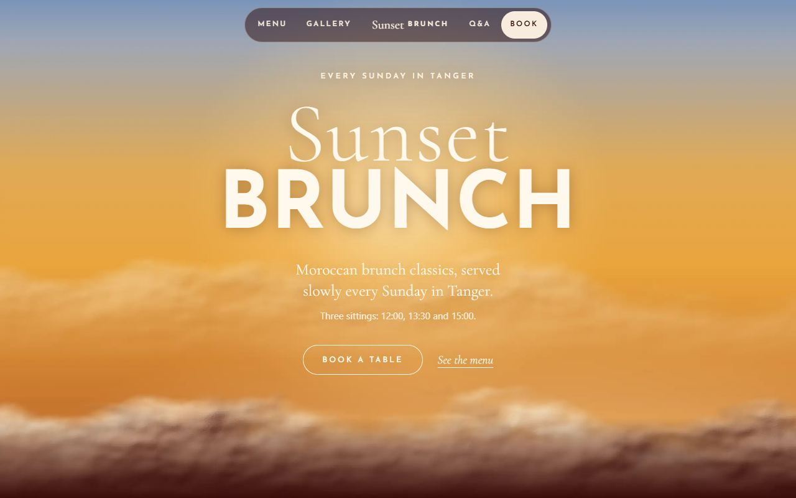
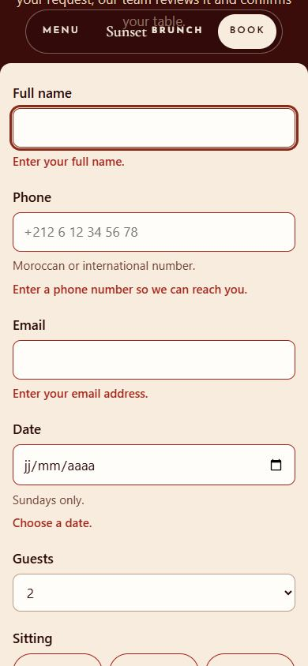
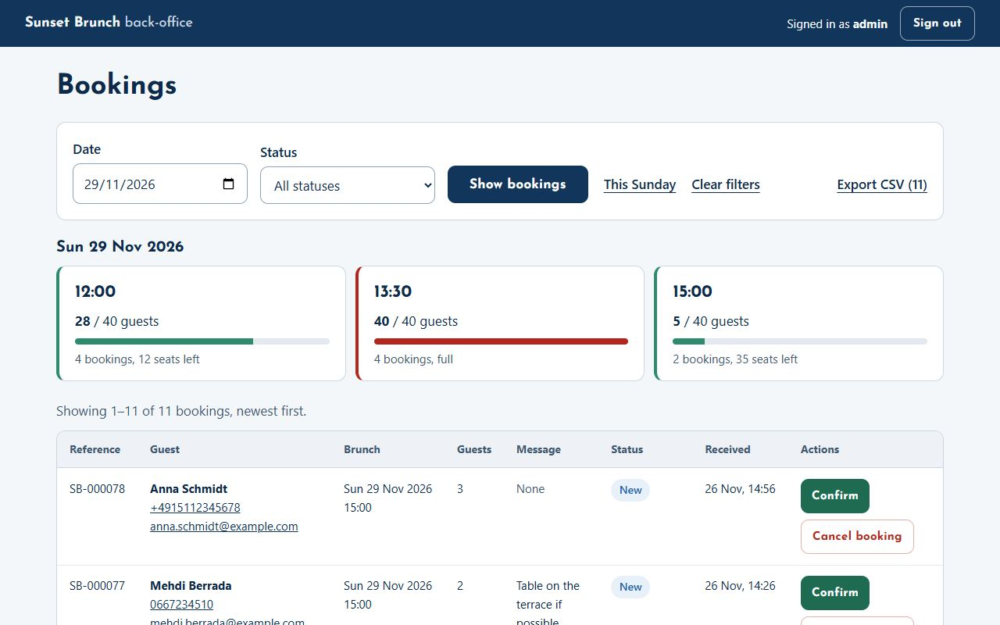

# Sunset Brunch: Sunday brunch booking

A one-page site where guests book a table for Sunday brunch at a restaurant in Tanger,
and a private back-office where staff see and manage the bookings.

Built for the ELH Groupe web developer test with **plain PHP 8, MySQL/MariaDB, HTML, CSS and
vanilla JavaScript**. No framework, no page builder. The only package is PHPMailer, for the bonus emails.

| Landing page | Booking on a phone | Back-office |
|---|---|---|
|  |  |  |

---

## What is included

| Brief | Where |
|---|---|
| **Part 1: landing page** | |
| Hero with name, tagline, background image, "Book a table" button scrolling to the form | `public/index.php` |
| Menu: 6 dishes with name, description and price in MAD, as cards | `config/menu.php`, `public/index.php` |
| Booking form: name, phone, email, date, sitting (12:00 / 13:30 / 15:00), guests (1–12), optional message | `public/index.php` |
| Works on mobile, tablet and desktop (checked from 320 px to 1440 px) | `public/assets/css/main.css` |
| JavaScript validation: required fields, email, phone, date not in the past and a Sunday | `public/assets/js/booking.js` |
| Sent with `fetch` (no reload), clear success or error message | `public/assets/js/booking.js` |
| **Part 2: back end** | |
| Endpoint that validates everything again on the server | `public/api/book.php`, `src/BookingValidator.php` |
| Saved in a `reservations` table with prepared statements (PDO) | `src/ReservationRepository.php` |
| Refused when the sitting would go over 40 guests, with a message the page shows | `src/BookingService.php`, `src/SlotLock.php` |
| Status: `new`, `confirmed` or `cancelled` | `database/schema.sql` |
| **Part 3: back-office** | |
| Login with a hashed password (one admin is enough; more are possible) | `public/admin/login.php`, `src/Auth.php` |
| Bookings list, newest first, filters by date and status | `public/admin/index.php` |
| Buttons to confirm or cancel a booking | `public/admin/status.php` |
| Logout | `public/admin/logout.php` |
| **Bonus tasks (all done)** | |
| Email to the guest after booking, and again when staff confirm | `src/BookingMailer.php` (PHPMailer) |
| CSV export of the (filtered) list | `public/admin/export.php` |
| SEO: title, description, Open Graph, Restaurant JSON-LD | `public/index.php` |
| Spam protection (honeypot + rate limit) and CSRF on the back-office | `public/api/book.php`, `src/Csrf.php` |
| Lighthouse 90+ on mobile: **99–100 Performance, 100 Accessibility, Best Practices and SEO** | see [Checks](#checks-that-were-run) |

---

## Quick start

### Requirements

- **PHP 8.1 or newer** (developed and tested on PHP 8.4) with `pdo_mysql` and `mbstring`
- **MySQL 8.0.16+ or MariaDB 10.4+** (XAMPP's MariaDB works)
- **Composer**, to install PHPMailer
- **Mailpit** (optional), to read the emails locally: <https://mailpit.axllent.org>

> **Windows / XAMPP:** the `mysql` command is `C:\xampp\mysql\bin\mysql.exe`. XAMPP 8.0 bundles PHP 8.0,
> which is too old: use PHP 8.1+ for the site (for example with `php -S` below).

### Steps

```bash
# 1. PHP dependencies (PHPMailer)
composer install

# 2. Database and tables
mysql -u root -p < database/schema.sql

# 3. A dedicated database user with only the rights the app needs (do not run the app as root)
mysql -u root -p -e "
  CREATE USER 'sunset_app'@'localhost' IDENTIFIED BY 'choose-a-strong-password';
  CREATE USER 'sunset_app'@'127.0.0.1' IDENTIFIED BY 'choose-a-strong-password';
  GRANT SELECT, INSERT, UPDATE, DELETE ON sunset_brunch.* TO 'sunset_app'@'localhost';
  GRANT SELECT, INSERT, UPDATE, DELETE ON sunset_brunch.* TO 'sunset_app'@'127.0.0.1';"

# 4. Configuration (config/config.php is git-ignored)
cp config/config.example.php config/config.php
#    Edit config/config.php: the database password from step 3, and a random ip_salt:
php -r "echo bin2hex(random_bytes(32));"
#    For local work you can also set 'debug' => true.

# 5. Check the setup (connection, tables, clock, GET_LOCK)
php bin/check-db.php

# 6. Create the back-office account (the password is typed at a prompt; only its hash is stored)
php bin/create-admin.php admin

# 7. Optional: fictional bookings on the next two Sundays, to try the back-office
mysql -u root -p sunset_brunch < database/demo-data.sql

# 8. Optional: catch the emails locally (inbox at http://127.0.0.1:8025)
mailpit --listen 127.0.0.1:8025 --smtp 127.0.0.1:1025

# 9. Start the site
php -S 127.0.0.1:8000 -t public
```

- Site: <http://127.0.0.1:8000>
- Back-office: <http://127.0.0.1:8000/admin/>
- Emails (with Mailpit running): <http://127.0.0.1:8025>

**Apache instead of `php -S`:** point the virtual host's `DocumentRoot` at `public/`, so nothing else
is reachable. As a safety net for a copy of the whole project into `htdocs`, the root `.htaccess` denies
`src/`, `config/`, `database/`, `bin/` and `storage/` (needs `mod_rewrite`; the project was tested with `php -S`).

**Without Composer or Mailpit** the site still works: bookings are saved, only the emails are skipped
(and the reason is written to `storage/logs/php-error.log`).

---

## How it works

### A booking, from the form to the database

```
booking.js            checks the fields (same rules as the server), sends them with fetch()
  → api/book.php      1. POST only   2. honeypot   3. rate limit   4. BookingValidator
                      5. BookingService::reserve() under the slot lock   6. JSON answer + email
  → page              shows the reference ("SB-000031") or the exact problem, field by field
```

The booking rules (sittings, 40 seats, 1–12 guests, 90-day window) live once in `config/booking.php`.
PHP passes them to the JavaScript as `data-*` attributes, so the browser and the server never disagree.

| Answer | When |
|---|---|
| `201` | Booking saved (status `new`) |
| `422` | A field is invalid; `errors` lists the message for each field |
| `409` | The sitting would go over 40 guests ("Only 4 seats are left…") |
| `429` | More than 5 bookings from the same visitor in 10 minutes |
| `503` | Another booking for the same sitting took longer than 5 seconds |
| `405` / `500` | Wrong method / unexpected error (details only in the log) |

### The 40-guest limit, safe under concurrent bookings

The rule: **guests of active bookings (`new` + `confirmed`) + the new guests must never exceed 40**
for one date and sitting. Cancelled bookings free their seats.

A naive "count, then insert" fails when two guests book the last seats at the same moment: both read
"36 booked" and both are saved (44 guests). `SlotLock` prevents this with a MySQL/MariaDB named lock:

- `GET_LOCK('sunset_brunch:slot:2027-01-31|13:30', 5)`: one request at a time per date and sitting;
  other sittings are not blocked.
- The lock belongs to the database connection, so the count and the insert run on the same shared PDO
  connection (`Database::connection()`).
- It is released in a `finally` block, and automatically if the connection closes.
- The back-office uses **the same lock**: confirming a cancelled booking takes its seats back, so the
  limit is checked again (`BookingService::changeStatus()`).

Measured with 10 processes booking 6 guests each at the same instant: **without the lock 60/40 guests,
with the lock 36/40** (6 accepted, 4 refused). An admin re-confirmation racing three guest bookings also
stayed within the limit in every run.

### Security

| Risk | Protection | Where |
|---|---|---|
| SQL injection | Prepared statements only, real (not emulated) prepares, values never concatenated | `src/ReservationRepository.php`, `src/Database.php` |
| XSS | Every value printed in HTML goes through `e()` (`htmlspecialchars`); a strict Content-Security-Policy (no inline scripts); JSON-LD encoded with `JSON_HEX_TAG`; emails escaped too | `src/helpers.php`, `src/bootstrap.php` |
| Passwords | `password_hash()` (bcrypt) / `password_verify()`; admins created from the command line, never in SQL | `src/Auth.php`, `bin/create-admin.php` |
| Session theft or fixation | New session id at login, `HttpOnly` + `SameSite=Lax` cookie (`Secure` on HTTPS), strict mode, 30-minute idle timeout | `src/Auth.php` |
| Password guessing | 5 failed logins per IP → 15-minute block; same message and same response time for an unknown username | `src/Auth.php` |
| CSRF | Random token per session in every admin form, checked with `hash_equals`; status changes and logout are POST only | `src/Csrf.php` |
| Protected pages | `Auth::requireAdmin()` on every admin page; no caching (`Cache-Control: no-store`), `noindex` | `public/admin/*` |
| Spam bookings | Hidden honeypot field + max 5 bookings per IP in 10 minutes (only a salted hash of the IP is stored) | `public/api/book.php` |
| Invalid data | Server validation of every field; the database also enforces `CHECK (guests BETWEEN 1 AND 12)` and `ENUM` sittings/statuses | `src/BookingValidator.php`, `database/schema.sql` |
| CSV injection | Cells starting with `= + - @` are prefixed with `'` so Excel shows them as text | `public/admin/export.php` |
| Secrets | `config/config.php` git-ignored; errors logged, never shown to visitors (`debug` off) | `.gitignore`, `src/bootstrap.php` |

### Back-office

- Newest bookings first, 20 per page, filters by date and status (kept in the URL, so a view can be shared).
- When a date is chosen: guests per sitting out of 40, with seats left.
- Confirm / Cancel buttons; after the action you return to the same filtered list with a one-time message.
- "This Sunday" shortcut and CSV export of exactly what the list shows (UTF-8, `;` separator for Excel in French).
- On phones and tablets each booking is a card; from 1200 px it is a table.

### Emails

PHPMailer sends two emails over SMTP: **"We received your booking request"** after booking and
**"Your table is confirmed"** when staff confirm. Locally Mailpit catches them; in production the
`mail` section of `config/config.php` points to a real provider. The SMTP timeout is 5 seconds and a
failed email never cancels a booking or a confirmation: the guest still gets their reference and the
error is logged.

---

## Project structure

```
public/                  Web root: the only folder the browser can reach
  index.php              Landing page: hero, menu, booking form, SEO tags, JSON-LD
  api/book.php           Booking endpoint (JSON)
  admin/                 login.php, index.php (list), status.php (confirm/cancel), export.php (CSV), logout.php
  assets/                css/, js/booking.js, img/ (WebP images + SVG sources), fonts/ (self-hosted)
src/
  bootstrap.php          Loaded first everywhere: config, time zone, error log, autoload, security headers
  Database.php           One shared PDO connection per request
  BookingValidator.php   Server-side validation of a booking
  BookingService.php     The 40-guest rule for new bookings and status changes
  SlotLock.php           GET_LOCK / RELEASE_LOCK around "count + write"
  ReservationRepository.php   Every SQL query on reservations
  BookingCalendar.php    Date rules: first/last bookable Sunday, sitting already started
  Auth.php, Csrf.php     Back-office login, sessions, throttling, CSRF tokens
  BookingMailer.php      The two guest emails (PHPMailer)
  helpers.php            e(), json_response(), redirect(), filters, one-time messages…
config/
  booking.php            Business rules (committed)
  menu.php               The six dishes
  config.example.php     Template for config.php (database, mail, secrets; git-ignored)
database/
  schema.sql             Tables, constraints, indexes (no admin account inside)
  demo-data.sql          Optional fictional bookings
bin/
  create-admin.php       Create an admin or reset its password
  check-db.php           Check PHP, database, clock and locks
```

---

## Checks that were run

Before submission the following was tested on the finished code (browser checks with Playwright, mobile
audits with Lighthouse 13.6):

| Check | Result |
|---|---|
| Lighthouse, mobile, home page (5 runs) | Performance **99–100**, Accessibility **100**, Best Practices **100**, SEO **100**; LCP 0.9 s, CLS 0 |
| Widths 320, 390, 768, 1024, 1440 px (home, login, list, filtered list) | No horizontal scroll, buttons and form controls ≥ 44 px (inline text links excepted), no console errors |
| Keyboard only | Booking and back-office (login, confirm) fully usable; visible focus ring on every stop |
| Form scenarios | Empty form, each invalid value, success, 422 / 409 / 429 / 500 / offline answers, double click sends once |
| Server validator | Impossible dates (31 Feb), past Sunday, beyond 90 days, sitting already started, arrays instead of text… |
| Capacity | 41 refused, exactly 40 accepted, cancelled seats freed, concurrent race (see above) |
| Security | SQL-injection and `<script>` input stored as plain text; forged POST without CSRF token, GET requests and signed-out requests change nothing |
| Emails | Both emails delivered to Mailpit; with the mail server stopped, bookings and confirmations still succeed |

**Try it yourself:** book a table with a free sitting (for example 15:00), confirm it in the back-office,
then open Mailpit to see both emails. To see the limit, import the demo data: the 13:30 sitting on the
first Sunday is full (40/40) and refuses any new booking.

---

## Assumptions and decisions

- **Capacity:** active guests + new guests must never exceed 40 (a sitting at 39 refuses a group of 2).
- **Booking window:** at most **90 days** ahead. This is an assumption; change `booking_window_days` in `config/booking.php`.
- **Same day:** on a Sunday, today can still be booked for sittings that have not started yet.
- **Time zone:** all "today" and "already started" checks use **Tanger time** (`Africa/Casablanca`) in the
  browser, in PHP and in MySQL, whatever the visitor's own time zone.
- **Phone numbers:** Moroccan (`06…`, `+212 6…`) or any international number in `+` format. Stored without spaces.
- **Honeypot in debug mode:** with `debug` on, a blocked booking shows a clear message instead of a fake
  success, so a test with an auto-fill tool is not mistaken for a real booking.
- **Content:** the restaurant is fictional; the six dishes and their prices are sample content.
- **Why a named lock rather than `SELECT … FOR UPDATE`:** it also covers an empty sitting (no rows to lock
  yet) and is simple to reason about.

### Known limitation

Morocco's time zone rules change often, so the server needs an **up-to-date time zone database**. On the
development PC, PHP 8.4.23's bundled data (2026.1) placed Tanger one hour ahead of Windows and Chrome.
Updating PHP (or installing the PECL `timezonedb` extension) fixes it without any code change.

---

## What I would improve with more time

- **Automated tests in the repository:** PHPUnit for `BookingValidator` and `BookingService` (including the
  lock), and the Playwright browser scenarios used above, run in CI on every push.
- **Seats left in the form:** a small availability endpoint so the sitting buttons show "3 seats left" or
  "Full" before the guest submits.
- **Guest self-service:** a signed link in the email to cancel or change a booking, and a reminder email
  the day before.
- **Cancellation email** when staff cancel, and an email template system instead of HTML in PHP strings.
- **Send emails in the background** (a small queue) so a slow mail server never delays the response.
- **Back-office:** search by name, phone or reference; edit a booking; several staff accounts with roles
  and an activity log; a printable list per sitting for the Sunday service.
- **French and Arabic versions** (with right-to-left layout), since most guests in Tanger would expect them.
- **Production setup:** HTTPS with HSTS, configuration from environment variables, a Docker Compose file
  (PHP, MariaDB, Mailpit) so the project runs with one command, and database migrations.
- **Real photos** of the dishes and the terrace, delivered as responsive WebP/AVIF.

---

## Credits

- Hero illustration, zellige tile and favicon: original SVGs made for this project (rendered to WebP for speed).
- Font: [Josefin Sans](https://fonts.google.com/specimen/Josefin+Sans) (SIL Open Font License), self-hosted
  from `@fontsource-variable/josefin-sans@5.3.0`.
- Email: [PHPMailer](https://github.com/PHPMailer/PHPMailer) 7.2.0 (LGPL 2.1), installed with Composer.
